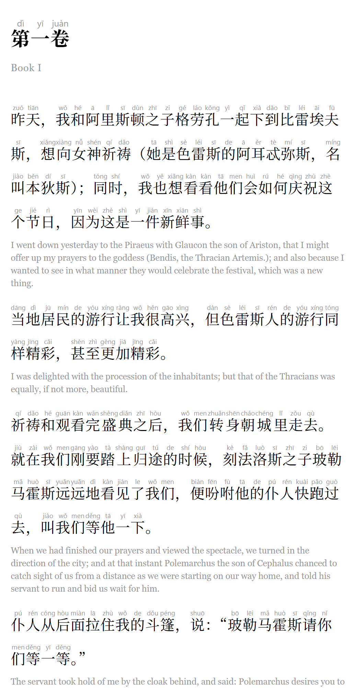

# Hanzi Reader

**Turn any English EPUB into a bilingual Chinese reader for learning to read hanzi.**

Upload a book, pick a chapter or a page range, and get back an EPUB in which every sentence is
written in natural Mandarin with tone-marked pinyin above it and the original English below. The
hanzi are the largest, darkest thing on the page, so your eyes land on them first and only drift to
the pinyin or English when you need help.

<p align="center">
  
</p>

<p align="center">
  
  <br>
  <sub>Output for the opening of Plato's <i>Republic</i> (Jowett translation, public domain)</sub>
</p>

## Why

Graded readers are great but there aren't many of them, and they're rarely books you'd pick
yourself. This lets you learn from whatever you're already reading. Each sentence stays a single
unit, so you can try reading the Chinese, glance up at the pinyin for a new character, and check the
English to see whether you understood.

## Features

- **Choose what to read:** pick chapters (grouped by part, shift-click for ranges) or a page range
  on a virtual paperback pagination of about 250 words per page.
- **Natural translations:** Claude Haiku 5.5 translates sentence by sentence, aligned one-to-one,
  with the surrounding passage as context. A glossary built as it goes keeps character and place
  names consistent across the whole book.
- **Word-aware pinyin:** Jieba segments the Chinese into words and pypinyin reads each word as a
  unit, so polyphonic characters get the right tone in context (银**行** háng, not xíng). Particles
  such as 地, 得 and 了 get their neutral-tone readings from Jieba's part-of-speech tags.
- **Real `<ruby>` markup:** one `<ruby>` per word, one `<rt>` per character, and `<rp>` fallbacks
  for readers without ruby support.
- **E-reader typography:** an embedded stylesheet written to work across Apple Books, Kobo, Google
  Play Books, KOReader, Calibre and Send to Kindle (see [below](#typography)).
- **Simplified or Traditional** characters.
- **A satisfying conversion:** live progress with translated sentences appearing as they arrive
  (you can hide the pinyin or English to test yourself), then stats on how many characters and
  unique hanzi you're about to read.
- **Cheap:** a typical novel chapter costs well under a cent to translate.

## How it works

```
EPUB ─▶ parse TOC & spine ─▶ paragraphs ─▶ sentences ─▶ Claude Haiku 5.5 ─▶ jieba + pypinyin ─▶ <ruby> XHTML ─▶ EPUB 3
```

| Step | Code |
| --- | --- |
| Read EPUB 2 and 3 files and follow the table of contents. Files that hold several chapters are split at the TOC's anchors, and mis-nested "Part Two" entries are regrouped. | [`epub_reader.py`](backend/app/epub_reader.py) |
| Split paragraphs into sentences with pysbd, folding stray quote marks back into the sentence before. | [`sentences.py`](backend/app/sentences.py) |
| Translate batches of about 24 sentences with a JSON schema (structured outputs), 6 requests in parallel. Skipped items are retried, and anything still missing falls back to English only. | [`translate.py`](backend/app/translate.py) |
| Segment with jieba, read each word with pypinyin, and emit ruby HTML. | [`annotate.py`](backend/app/annotate.py) |
| Write a fresh EPUB 3 (plus an NCX for older readers) with the cover, a title page, translated chapter titles, and the stylesheet. | [`epub_writer.py`](backend/app/epub_writer.py) |
| Run jobs in the background and stream progress to the browser over server-sent events. | [`jobs.py`](backend/app/jobs.py), [`main.py`](backend/app/main.py) |

### Typography

The stylesheet ([`hanzi.css`](backend/app/hanzi.css)) is the heart of the reading experience:

- **Hierarchy:** hanzi at 1.32em in a CJK serif, pinyin at under half that size in a light grey sans
  serif, and English at 0.8em in grey. The hanzi inherit the reader's text colour, so night and
  sepia themes keep working.
- **Line-height** of about 2.35 on the Chinese lines leaves room for the ruby text without lines colliding.
- **`ruby-align: center`** and `ruby-position: over`, with `-webkit-` and `-epub-` prefixes for older engines.
- **`page-break-inside: avoid`** (plus `break-inside` and `-webkit-column-break-inside`) on each
  sentence pair, so pinyin, hanzi and English never split across pages.
- **Narrow-screen rules** for phones, and left alignment, because justified text stretches ruby awkwardly.

## Tech stack

- **Backend:** Python, FastAPI, Anthropic Python SDK, jieba, pypinyin, pysbd, lxml
- **Frontend:** React, TypeScript, Vite, Tailwind CSS v4, shadcn/ui

## Running it locally

Requirements: Python 3.11+, Node 20+, and an [Anthropic API key](https://console.anthropic.com/).

```bash
# Backend
cd backend
python -m venv .venv
.venv/Scripts/pip install -r requirements.txt   # macOS/Linux: .venv/bin/pip
cp .env.example .env                            # then put your key in ANTHROPIC_API_KEY

# Frontend
cd ../frontend
npm install
npm run build

# Run (serves the built frontend too)
cd ../backend
.venv/Scripts/python -m uvicorn app.main:app --port 8000
```

Then open <http://localhost:8000>.

For frontend development with hot reload, keep the backend running and start `npm run dev` in
`frontend/`, then open <http://localhost:5173> (it proxies `/api` to port 8000).

**No API key?** Run `.venv/Scripts/python tests/demo_server.py` in `backend/` and open
<http://localhost:8001>. It uses canned translations so you can click through the whole flow.

## Tests

```bash
cd backend
.venv/Scripts/python -m pytest tests -q
```

The tests generate a small sample book and stub out the translator, so they don't call the API.

## Notes and limitations

- Use DRM-free EPUBs that you own. Generated books are for your personal study.
- Pinyin uses dictionary tones and doesn't mark third-tone sandhi, which matches most dictionaries
  and graded readers. 一 and 不 follow pypinyin's phrase readings.
- Machine translation is very good but not perfect. Treat the English line as the source of truth.
- Uploaded books and generated EPUBs are kept in memory and the system temp folder, so they're gone
  after a restart. This is meant to run on your own machine.

## Project layout

```
backend/
  app/            FastAPI app and the conversion pipeline
  tests/          pipeline tests, sample-book generator, demo server
frontend/
  src/components/ upload, selection, and conversion screens (shadcn/ui)
  src/lib/api.ts  API client and cost/time estimates
docs/             screenshots
```
