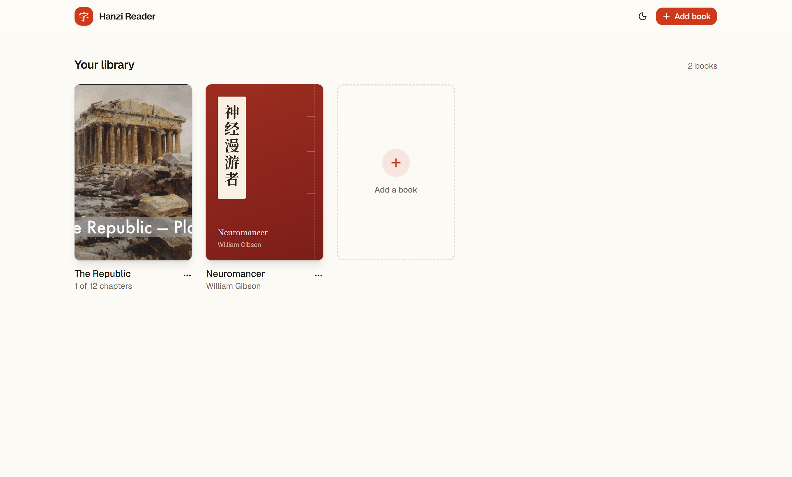
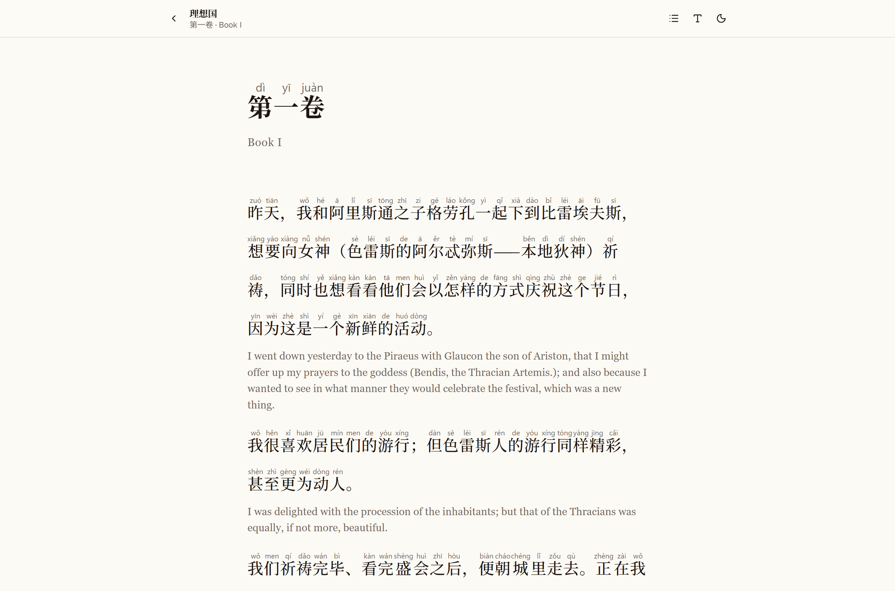
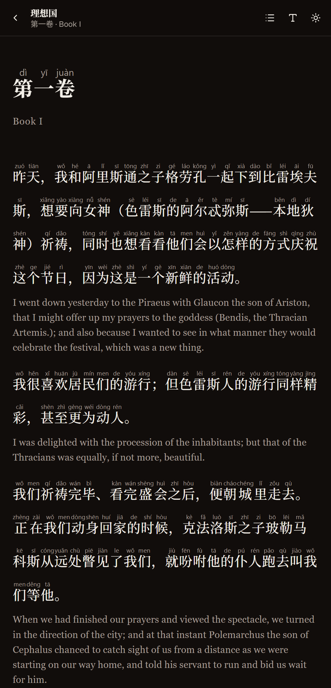

# Hanzi Reader

**Read the books you love in Chinese, with pinyin above every character and the original English below.**

Hanzi Reader turns English EPUBs into bilingual Chinese readers and gives you a place to read them.
Every sentence is translated into natural Mandarin and shown with tone-marked pinyin above it and the
original English below. The hanzi are the largest, darkest thing on the page, so your eyes land on
them first and only drift to the aids when you need help.

<p align="center">
  
</p>

<p align="center">
  
  &nbsp;
  
  <br>
  <sub>Plato's <i>Republic</i> (Jowett translation, public domain) in the reader, desktop light mode and phone dark mode</sub>
</p>

## Why

Graded readers are great, but there aren't many of them, and they're rarely books you'd pick
yourself. This lets you learn from whatever you're already reading. Each sentence stays a single
unit, so you can try reading the Chinese, glance up at the pinyin for a new character, and check the
English to see whether you understood.

## Features

**Reading**

- **A library** of your translated books as a grid, with your own covers or generated ones styled
  like traditional thread-bound books, plus a "Continue reading" card that takes you back to where you were.
- **A distraction-free reader** that works on phones and desktops, with a contents sheet grouped by
  part, chapter-to-chapter navigation (also with ← / →), and a top bar that hides while you read.
- **Hide the aids to test yourself:** turn pinyin or English off, then tap a sentence (or hover on
  desktop) to reveal it for that sentence only.
- **Light and dark mode**, six text sizes, and your reading position saved per book.
- **Download any book as an EPUB** for Apple Books, Kobo, Google Play Books, KOReader or Kindle.

**Translating**

- **Pick what to translate:** whole chapters (grouped by part, shift-click for ranges) or a page
  range. You can come back later to translate more of the same book, and chapters already in your
  library are marked.
- **Natural translations:** Claude Haiku 5.5 translates sentence by sentence, aligned one-to-one,
  with the surrounding passage as context. A glossary built as it goes keeps character and place
  names consistent across the whole book.
- **Word-aware pinyin:** jieba segments the Chinese into words and pypinyin reads each word as a
  unit, so polyphonic characters get the right tone in context (银**行** háng, not xíng). Particles
  such as 地, 得 and 了 get their neutral-tone readings from jieba's part-of-speech tags.
- **Start reading straight away:** chapters are translated in parallel and appear in your library as
  each one finishes, while live progress shows sentences as they're translated.
- **Cheap:** a whole novel (Neuromancer, about 80,000 words) took about six minutes and cost
  well under a dollar in API usage.

## How it works

```
EPUB ─▶ chapters & paragraphs ─▶ sentences ─▶ Claude Haiku 5.5 ─▶ jieba + pypinyin ─▶ library (JSON) ─▶ reader / EPUB
```

| Step | Code |
| --- | --- |
| Read EPUB 2 and 3 files and follow the table of contents. Files that hold several chapters are split at the TOC's anchors, and mis-nested "Part Two" entries are regrouped. | [`epub_reader.py`](backend/app/epub_reader.py) |
| Split paragraphs into sentences with pysbd. | [`sentences.py`](backend/app/sentences.py) |
| Translate batches of about 24 sentences with a JSON schema (structured outputs), 6 requests in parallel. Skipped items are retried, and anything still missing falls back to English only. | [`translate.py`](backend/app/translate.py) |
| Segment with jieba, read each word with pypinyin, and emit one `<ruby>` per word with one `<rt>` per character. | [`annotate.py`](backend/app/annotate.py) |
| Translate chapters concurrently and save each to the library as soon as it's done. | [`jobs.py`](backend/app/jobs.py) |
| Store each book as `meta.json` plus one JSON file per chapter, with the ruby HTML already rendered. | [`library.py`](backend/app/library.py) |
| Build an EPUB 3 (plus an NCX for older readers) from the library on demand. | [`epub_writer.py`](backend/app/epub_writer.py) |
| Serve the library, the reader's chapters and the wizard, and stream conversion progress over server-sent events. | [`main.py`](backend/app/main.py) |

### Typography

The same hierarchy is used in the web reader and in the exported EPUB
([`hanzi.css`](backend/app/hanzi.css)):

- **Hanzi** in a CJK serif at the reading size, in the theme's text colour.
- **Pinyin** at under half that size, in a light grey sans serif.
- **English** smaller, in grey serif.
- **Line-height** of about 2.4 on Chinese lines leaves room for the ruby text, and `ruby-align` /
  `ruby-position` are set with `-webkit-` and `-epub-` prefixes for older engines.
- **`page-break-inside: avoid`** (plus `break-inside`) on each sentence pair in the EPUB, so pinyin,
  hanzi and English never split across pages.

## Tech stack

- **Backend:** Python, FastAPI, Anthropic Python SDK, jieba, pypinyin, pysbd, lxml
- **Frontend:** React, TypeScript, Vite, Tailwind CSS v4, shadcn/ui

## Running it locally

Requirements: Python 3.11+, Node 20+, and an [Anthropic API key](https://console.anthropic.com/).

```bash
# Backend
cd backend
python -m venv .venv
.venv/Scripts/pip install -r requirements.txt   # macOS/Linux: .venv/bin/pip
cp .env.example .env                            # then put your key in ANTHROPIC_API_KEY

# Frontend
cd ../frontend
npm install
npm run build

# Run (serves the built frontend too)
cd ../backend
.venv/Scripts/python -m uvicorn app.main:app --port 8000
```

Open <http://localhost:8000> and press **Add book** to translate your first EPUB.

To translate a whole book from the terminal instead, without keeping a browser open:

```bash
cd backend
.venv/Scripts/python -m app.cli path/to/book.epub --list            # see chapter numbers
.venv/Scripts/python -m app.cli path/to/book.epub                   # every chapter
.venv/Scripts/python -m app.cli path/to/book.epub --chapters 3,5-8 --script traditional
```

For frontend development with hot reload, keep the backend running, start `npm run dev` in
`frontend/`, and open <http://localhost:5173>.

**No API key?** Run `.venv/Scripts/python tests/demo_server.py` in `backend/` and open
<http://localhost:8001>. It uses canned translations so you can click through the whole flow.

## Tests

```bash
cd backend
.venv/Scripts/python -m pytest tests -q
```

The tests generate a small sample book and stub out the translator, so they don't call the API.

## Notes and limitations

- Use DRM-free EPUBs that you own. Translated books are for your personal study, which is why the
  library folder (`backend/library/`) is ignored by git.
- Pinyin uses dictionary tones and doesn't mark third-tone sandhi, which matches most dictionaries
  and graded readers.
- Machine translation is very good but not perfect. Treat the English line as the source of truth.
- It's built to run on your own machine: there are no accounts, and reading progress and settings
  live in your browser.

## Project layout

```
backend/
  app/            FastAPI app, conversion pipeline, library storage, CLI
  tests/          pipeline tests, sample-book generator, demo server
  library/        your translated books (git-ignored)
frontend/
  src/pages/      library, reader, and add-a-book wizard
  src/components/ shared UI (shadcn/ui), book covers, wizard steps
  src/lib/        API client, hash router, persisted settings
docs/             screenshots
```
